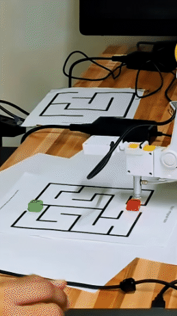

# Maze-solving Dobot

<p align="center">
  
</p>

Put a green and a red marker anywhere in a maze. The robot takes a picture from above, finds a path between them, and traces it with the arm.

This was Midterm 2 (Solving a 4x4 Maze) in RAS 545 Robotic Systems I at Arizona State University, Fall 2025.

[](https://youtube.com/shorts/dg8OyQElKI4)

## How it works

**Seeing the maze** (`hybrid_maze_solver.py`)

1. Find the green and red markers with HSV color ranges and take the center of the biggest blob for each.
2. Turn the walls into a binary mask (Otsu threshold), then flood fill from the border so only the inside of the maze counts as open space.
3. Run a distance transform so every open pixel knows how far it is from the nearest wall.

**Planning the path**

4. Shrink the open area by 15 px so the path can't hug the walls. If no path exists at that margin, try 14, 13, and so on.
5. Run A* with an extra cost for being near a wall, which keeps the path in the middle of the corridors.
6. If A* fails, fall back to BFS on the skeleton of the open area, and then to plain BFS.
7. Simplify the path with Ramer-Douglas-Peucker. On the lab maze this took it from **848 points down to 8 waypoints**.

**Moving the robot** (`robot_maze_controller.py`)

8. Convert every waypoint from pixels to robot millimeters using the homography in `calibration_final.json`, plus an X/Y offset I measured on the real arm.
9. Move to the start marker, then go through the waypoints at a fixed height.

There's also an optional Gemini step. Before solving, it describes the maze. After, it looks at the solved image and checks that the path goes from start to end without crossing a wall. It's only a second opinion; the path itself always comes from the planner above.

## The part that took the longest

Lighting. Under the lab lights the red marker looked almost black to the camera and the green one looked dark green, so fixed color values kept missing them. Switching to HSV ranges (two ranges for red, since red wraps around the hue circle) fixed it for most lighting. The TA ran it 3 to 4 times to make sure it held up before signing it off.

Following all 848 raw points worked too, but the arm moved in tiny jerky steps and was slow. Cutting it to a handful of waypoints made the motion smooth without leaving the corridors.

## Running it

```bash
pip install -r requirements.txt
export GEMINI_API_KEY=...        # optional, only for the Gemini check
python robot_maze_controller.py --start green --camera 1
```

To try only the solver on a photo of a maze:

```bash
python hybrid_maze_solver.py maze.jpg green
```

It writes `path.csv` (the waypoints) and `solved_path.png` (the path drawn on the image).

The controller also expects `robot_calibration.json` with the ruler scale I measured in the lab, in the form `{"pixels_per_mm": <value>}`. That file wasn't in my submission folder, so make your own with the value for your camera. The calibration values here are from my setup and will be different on another arm.
